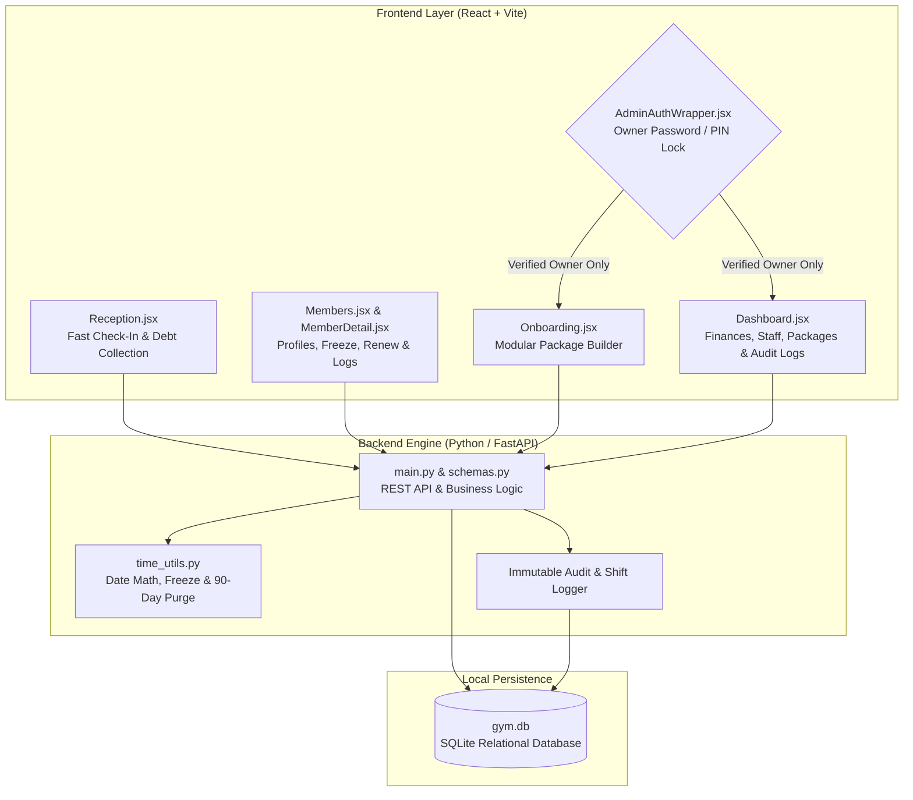

# 🏋️‍♂️ GymOS — Offline-First Gym Management & Anti-Theft ERP


> **Quick Repo Description (for GitHub "About" section):**  
> Offline-first Gym Management & Financial ERP desktop web application built with Python (FastAPI) & React. Features instant ID check-ins, modular checkbox package building, add-on session tracking (e.g., Treadmill), owner PIN/password anti-theft locks, immutable audit logs, and custom date-range financial reporting.
>
> **Suggested GitHub Topics:**  
> `python` `fastapi` `react` `vite` `sqlite` `gym-management-system` `offline-first` `erp` `pos` `role-based-access-control` `audit-log` `desktop-app`

---

## 📖 Overview

**GymOS** is a bespoke, high-speed, offline-first web-desktop application engineered around real-world gym reception workflows and strict financial accountability. Designed to run locally on reception hardware with zero internet dependency, it pairs an asynchronous **Python (FastAPI + SQLAlchemy)** backend with a reactive **Vite + React** frontend and single-click Windows batch launchers (`Start Gym App.bat` & `Stop Gym App.bat`).

Built specifically to eliminate revenue leakage and receptionist cash-handling discrepancies, GymOS hard-locks member onboarding and financial analytics behind owner credentials while keeping daily reception check-ins effortless and instantaneous.

---

## 🧭 System Architecture & Security Flow

The system enforces a strict separation of privileges between reception shifts and gym ownership using an authentication gate (`AdminAuthWrapper.jsx`) and backend PIN/password verification.



---

## 🖥️ Interface Wireframes & Workflow Illustrations

### 1. High-Speed Reception Desk (`Reception.jsx`)
Engineered for zero-latency keyboard operation during peak gym hours. Receptionists type an ID or search a name and press `Enter` to log attendance and view standing immediately:

```text
+-----------------------------------------------------------------------------------+
| [🔍 Enter Member ID or Search Name...                                  ] [Check-In]|
+-----------------------------------------------------------------------------------+
|  🟢 STATUS: ACTIVE (WARNING: OWES 200 EGP)                       ID: #104         |
|  Member: Ahmed Hassan                   Package: 24-Session Pass + Treadmill      |
|  Start Date: 2026-10-01                 End Date: 2027-01-01                      |
|                                                                                   |
|  [ Sessions Attended: 14 / 24 ]         [ 🏃 Treadmill Add-On: 6 / 12 Used ]      |
|  [ Paid: 1,000 EGP | Owed: 200 EGP ]                                              |
|                                                                                   |
|  Actions: [ ⚡ Consume Treadmill ] [ 💵 Pay Owed Debt ] [ ❄️ Freeze ] [ 🔄 Renew ] |
+-----------------------------------------------------------------------------------+
|  🕒 RECENT ATTENDANCE LOGS                                                        |
|  • 2026-11-08 — 04:32:10 PM (Session #14 Checked In)                              |
|  • 2026-11-06 — 07:15:44 PM (Session #13 Checked In + Treadmill Consumed)         |
+-----------------------------------------------------------------------------------+
```

### 2. Modular Package Builder & Onboarding (`Onboarding.jsx`)
Protected by the Owner PIN/Password lock so new memberships and upfront subscription fees cannot be pocketed or created off-the-books:

```text
+----------------------------------------+------------------------------------------+
| 👤 NEW MEMBER DETAILS                  | 📦 MODULAR PACKAGE BUILDER               |
|                                        |                                          |
| Full Name:  [________________________] | [x] 24-Session Pass           (800 EGP)  |
| Phone No.:  [________________________] | [ ] 1-Month Unlimited         (600 EGP)  |
| Assigned ID:[ Auto / Recycled #ID    ] | [x] Treadmill Add-On (12x)    (400 EGP)  |
|                                        | [ ] Single Session Walk-In     (50 EGP)  |
|                                        |------------------------------------------|
|                                        | 💰 Total Required:            1,200 EGP  |
|                                        | 💵 Amount Paid Today:       [ 1,000 EGP] |
|                                        | ⚠️ Remaining Owed Balance:      200 EGP  |
|                                        |                                          |
|                                        |        [ 🔒 Confirm & Create Member ]    |
+----------------------------------------+------------------------------------------+
```

### 3. Owner Executive Dashboard (`Dashboard.jsx`)
A password-protected command center with custom date-range filtering for complete financial and operational oversight:

```text
+-----------------------------------------------------------------------------------+
| 🔒 EXECUTIVE DASHBOARD     [  📅 From: 2026-10-01  To: 2026-11-08 ] [ Filter ]     |
+-----------------------------------------------------------------------------------+
| [ 💰 Finances & Expenses ] [ 📦 Manage Packages ] [ 👥 Receptionists ] [ 📜 Logs ] |
+-----------------------------------------------------------------------------------+
|  📈 Total Income: 48,500 EGP   📉 Total Expenses: 11,200 EGP   💵 Net: 37,300 EGP |
|-----------------------------------------------------------------------------------|
|  📜 IMMUTABLE SYSTEM AUDIT TRAIL                                                  |
|  • [2026-11-08 16:10] Receptionist (Shift #2): Collected 200 EGP debt from ID #104|
|  • [2026-11-08 15:45] Owner: Onboarded new member ID #219 (Paid: 800 EGP)         |
|  • [2026-11-08 14:12] Receptionist (Shift #1): Froze subscription for ID #088     |
+-----------------------------------------------------------------------------------+
```

---

## ✨ Key Features & Capabilities

### 🛡️ 1. Anti-Theft Security & Role Restrictions
* **Owner-Only Onboarding & Dashboard Gate:** Secured via `AdminAuthWrapper.jsx` and backend PIN/password verification. Only the gym owner can onboard new members, modify packages, or view financial data—completely preventing unrecorded sign-ups and subscription fee theft.
* **Granular Receptionist Accountability:** Tracks active receptionists and staff members so the owner knows exactly who checked in a member, who collected an owed balance, and when it occurred.
* **Immutable Audit Trail:** Every sensitive action (subscription creation, debt payment, freeze/unfreeze, package edit, or expense entry) is stamped with the exact date, time, and actor in the system logs.

### ⚡ 2. High-Speed Reception & Attendance Engine
* **Instant ID & Fuzzy Name Search:** Type a Member ID or match a name to pull up the member's complete profile card and log attendance in milliseconds.
* **Add-On Session Tracking (Treadmill & Extras):** Unlike standard local gym software that only tracks base memberships, GymOS tracks independent add-on quotas (such as Treadmill sessions) and single-session walk-ins with dedicated consumption buttons.
* **Automated 90-Day ID Recycling:** If an inactive member does not renew their subscription within 3 months (90 days), the system automatically purges their stale profile and recycles their numeric ID for the next new sign-up.

### 🔄 3. Subscription Lifecycle Management
* **Modular Checkbox Package Builder:** Combine base plans with equipment add-ons dynamically during sign-up with live price calculation.
* **Smart Freeze & Unfreeze Math:** Pause a member's subscription with one click; upon unfreezing, `time_utils.py` calculates the exact number of frozen days and automatically extends their subscription end date.
* **Instant One-Click Renewal:** Renew expired or depleted memberships directly from `MemberDetail.jsx` without re-entering member information.
* **Partial Payments & Debt Tracking:** Calculates remaining balances automatically (`Total Required - Amount Paid`), flags members who owe money on check-in, and supports instant debt settlement at the reception desk.

### 📊 4. Advanced Financial ERP & Custom Date Reporting
* **Income & Expense Ledger:** Record and categorize all operational gym expenses alongside subscription and add-on revenues.
* **Custom Date-Range Reports:** Generate detailed financial breakdowns between any two user-defined dates to inspect daily, weekly, monthly, or custom-period profitability.
* **Package & Staff Management Tabs:** Add, edit, or reprice gym packages and manage receptionist/staff profiles directly from the dashboard UI.
* **Bilingual / Arabic UI Support:** Built-in localization support for seamless Arabic interface operation.

---

## 📂 Repository Structure

```text
GYM/
├── Start Gym App.bat              # Single-click Windows launcher (starts Backend + Frontend)
├── Stop Gym App.bat               # One-click graceful shutdown script for all app processes
├── backend/
│   ├── main.py                    # FastAPI application entry point & API endpoints
│   ├── database.py                # SQLite connection & SQLAlchemy session setup
│   ├── models.py                  # Relational database schemas (Members, Subscriptions, Logs, etc.)
│   ├── schemas.py                 # Pydantic data validation & serialization models
│   ├── time_utils.py              # Date calculations, freeze durations & expiration helpers
│   └── gym.db                     # Local SQLite database instance
└── frontend/
    ├── package.json               # React + Vite dependencies and scripts
    ├── vite.config.js             # Vite bundler configuration
    └── src/
        ├── App.jsx                # Main application router & navigation layout
        ├── AdminAuthWrapper.jsx   # Password/PIN security gate for Owner-only routes
        ├── Reception.jsx          # High-speed check-in, search & add-on consumption desk
        ├── Onboarding.jsx         # Owner-restricted new member & checkbox package builder
        ├── Members.jsx            # Searchable member directory & status filters
        ├── MemberDetail.jsx       # Member profile, attendance timestamps, freeze & debt tools
        ├── Dashboard.jsx          # Executive ERP: Finances, date filters, packages, staff & logs
        └── api.js                 # API client connecting React frontend to FastAPI backend
```

---

## 🚀 Getting Started & Installation

### Option 1: Single-Click Desktop Mode (Windows)
Designed for daily gym operation without touching a terminal:
1. Double-click **`Start Gym App.bat`** to start both the Python FastAPI backend and the React desktop interface automatically.
2. Double-click **`Stop Gym App.bat`** when closing the gym to cleanly shut down all background processes.

### Option 2: Manual Developer Setup

#### Prerequisites
* **Python** 3.10+
* **Node.js** 18+ & **npm**

#### 1. Start the Backend Server
```bash
cd backend
pip install fastapi uvicorn sqlalchemy pydantic
uvicorn main:app --reload --port 8000
```

#### 2. Start the Frontend Application
```bash
cd frontend
npm install
npm run dev
```
Open your browser to `http://localhost:5173` to access the application.

---

## 🔒 Security & Data Privacy
Because **GymOS** operates as a local, offline-first desktop web application backed by an on-premise SQLite database (`gym.db`), gym operations never halt during internet outages, and sensitive member and financial records never leave the facility's local machine.
